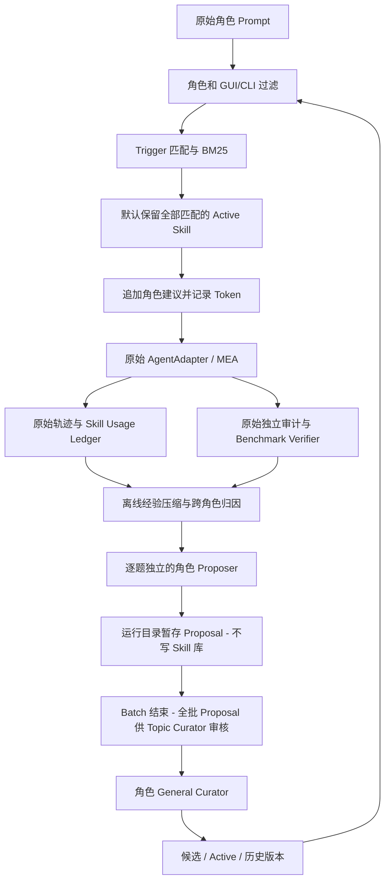

# 架构与运行边界



没有第四个常驻 Agent。离线分析可读取三个角色的压缩记录，在线角色只接收自己匹配的 Active Skill，
默认不限制条数与注入 Token 总量。显式配置的旧实验数量和 Token 上限仍可复现。

## 模块

| 模块 | 职责 |
|---|---|
| schema.py | 严格 JSON 对象、角色、模态、长度、权限和敏感信息校验 |
| library.py | 角色目录、原子更新、写锁、候选支持、历史、回滚和冻结 SHA256 |
| router.py | 角色/模态过滤、Trigger、BM25、默认全量匹配注入；兼容显式数量和 Token 上限 |
| trajectory_compactor.py | 流式轨迹提取、错误、重复动作和脱敏 |
| experience.py | root LLH 与冻结 TB 的真实日志别名映射、原始审计解析、评分器证据 |
| attribution.py | 主因、贡献角色、证据、置信度与 DEFER |
| proposer.py | 三角色成功/失败 Proposal；逐字证据核验 |
| curator.py | 角色内接纳、合并、更新、拒绝与延迟；保留旧能力 |
| learning.py | 训练集门禁、独立角色选择、逐题 Proposal 暂存与完整性校验、批次审核更新 |
| integration.py | 无侵入角色 Adapter 包装；原始 Prompt Builder 的可选兼容包装 |
| client.py | 现有显式 Endpoint 的无工具离线 JSON 请求；真实 Usage |
| statistics.py | 运行与学习成本分开统计；缺失为 null |
| prompts.py | 完整 MEA 专用学习 Prompt |
| cli.py | skills 子命令 |

## Library

```text
<library>/
  manager/shared/*.json
  executor/{gui,cli,shared}/*.json
  auditor/{gui,cli,shared}/*.json
  candidates/{manager,executor,auditor}/*.json
  .history/<role>/<modality>/<name>/<version>.json
  index.json
  stats.json
  frozen.json
```

Skill 身份是 role/modality/name。跨角色、跨 GUI/CLI 的合并会被拒绝；确需共享的方法应另建
相应角色/模态的受约束版本。候选也保留来源和逐字证据。相同任务的不同 round、重跑、别名
不增加独立支持数；原始任务文本指纹用于抵御别名重复计数。

每次写入保存不可覆盖的历史 JSON，再原子更新当前项和索引。回滚创建一个新的审计版本，
不删除后续历史。冻结摘要覆盖索引、内容、统计和历史；运行账本放在 run 目录，不写冻结库。

## 三个 Benchmark

TB 通过独立 `harbor_skill_agent` 包装官方原版 `_make_episode_adapter`，原版 `run` 方法直接继承。
WeaveBench 实际加载 `WeaveBench/weavebench/agents/cua_harness_claudecode_agent.py` 指定的
`CUA_HARNESS_SOURCE_DIR`；OSWorld 实际加载 hybrid `mm_agents/cua_harness_claudecode_agent.py`
指定的相同环境变量。两个 GUI 实验的 overlay 只包装各自原始 orchestrator 调用的 Adapter；
其余源码从受保护 Worktree 逐字复制，原 orchestrator 另存 `_original_orchestrator.py`。
评分器、任务资产和原启动脚本不复制修改。

GUI overlay 的生成和导入测试不能代替真实 GUI Benchmark；完整运行仍需要原版 VM、网站、
认证、任务资产和可用图像服务。
